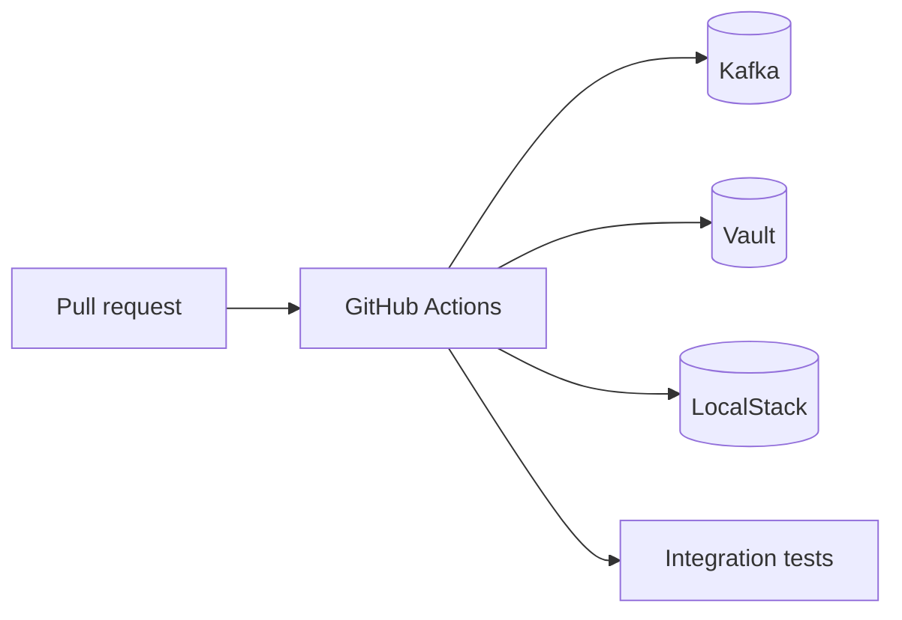

# Design

## Context

Integration tests need real Kafka, Vault, and AWS-compatible services. CI runs inside GitHub Actions with service containers. See proposal.md for motivation.

## Goals / Non-Goals

**Goals:**

- Boot service containers for Kafka, Vault, and LocalStack.
- Run tests with a build tag `integration`.
- Keep unit test job fast and independent.

**Non-Goals:**

- Full end-to-end production deployment checks.

## Decisions

### Decision 1: GitHub service containers over docker-compose

Service containers integrate with runner networking and require less setup.

- Alternative: docker-compose. Rejected: slower and less native to runners.

### Decision 2: Build tags isolate integration tests

Tests live under `tests/integration/` with `//go:build integration`. Default `go test ./...` skips them.

- Alternative: environment flags. Rejected: build tags are idiomatic in Go.

## Risks / Trade-offs

- Flaky brokers in CI. → Add retry and startup health checks.
- Secret leaks in logs. → Redact values in output.

## Migration Plan

1. Add workflow and Makefile targets.
2. Add smoke test.
3. Expand coverage after stability.

## Open Questions

None.

## Diagram

