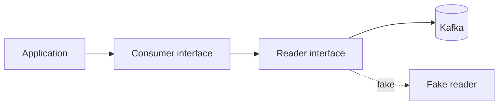
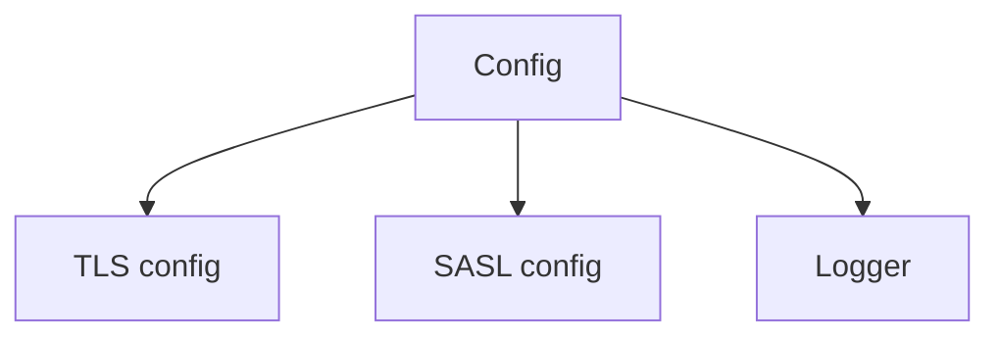

# Design

## Context

The library currently exposes concrete structs for consumers and producers. Configuration objects hold private state and expose getters only. Tests must spin up Kafka brokers to exercise most paths. See proposal.md for motivation.

## Goals / Non-Goals

**Goals:**

- Expose narrow interfaces for reader, writer, logger, and monitor.
- Keep existing public constructors compiling.
- Provide fake implementations for tests and examples.

**Non-Goals:**

- Rewrite the underlying segmentio/kafka-go usage.
- Change Kafka protocol behavior.

## Decisions

### Decision 1: Interfaces wrap concrete structs

We introduce `ReaderInterface` and `WriterInterface` that mirror the methods callers use. Concrete structs implement them. Tests inject fakes.

- Alternative: Use generics. Rejected: Go 1.19 lacks constraints maturity and adds noise.

### Decision 2: Configuration stays immutable after construction

Constructors accept values and validate. No setters. This prevents races at runtime.

- Alternative: Functional options. Kept as optional enhancement for large configs.

### Decision 3: Fakes live in a `testkit` package

Fakes stay separate from production code. Importers opt in only for tests and examples.

## Risks / Trade-offs

- Interface churn may break downstream mocks. → Keep interfaces minimal.
- Extra packages increase maintenance. → Limit fakes to reader/writer/monitor.

## Migration Plan

1. Add interfaces without removing structs.
2. Move callers to interfaces in follow-up pull requests.
3. Publish release notes and examples.

## Open Questions

None.

## Diagram

